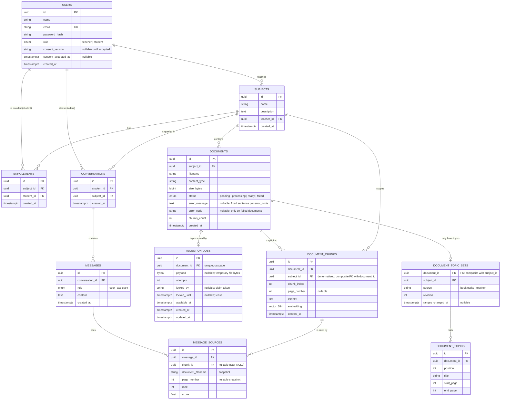

# Data Model (AsistenteIA)

Canonical database model. PostgreSQL 15 + `pgvector`. Managed only through Alembic migrations.
`readme.md` section 3 is a simplified academic summary; if they diverge, this document wins (see `base-standards.md` §0).

Status: `users`, `subjects`, `enrollments`, `documents`, `document_chunks` and `ingestion_jobs` are **implemented** (migrations `0002` to `0005`); the conversation tables are a **proposed design for implementation**. The differences from the `readme.md` summary are listed in [Changes vs readme.md](#changes-vs-readmemd).

## Entity Relationship Diagram

## Entities

### users
- `id` uuid PK (default `gen_random_uuid()`); `name` varchar(100) not null; `email` varchar(255) unique not null (ASCII only and stored lowercase, enforced by check constraints `ck_users_email_lowercase`: `email = lower(email)` and `ck_users_email_ascii`: `octet_length(email) = char_length(email)`; internationalised domains are stored in punycode); `password_hash` text not null (Argon2id); `role` PostgreSQL enum type `user_role` (`teacher`, `student`) not null, with the server default `'student'` (migration `0006`).
- `consent_version` varchar(20) and `consent_accepted_at` timestamptz: evidence of the privacy-policy acceptance; only the latest acceptance is stored (re-acceptance overwrites both). The recorded version must equal the currently configured policy version (`PRIVACY_POLICY_VERSION`). The API must refuse chat usage until consent for the current version is recorded (enforced by the chat change).
- Teacher accounts are created only by the `python -m app.cli create-teacher` and `seed` commands (public registration creates students), so a role can never be self-assigned. This is also enforced by the database (change `database-least-privilege`, option A of DD-9): the registration code does not name `role`, PostgreSQL supplies `student`, and the application role has no `INSERT` or `UPDATE` privilege on `users.role`; the commands run under a separate CLI role (`asistente_cli`, credential in `backend/.env.cli`) that the API never holds.
- Validation: email format and ASCII-only characters (look-alike Unicode addresses cannot become separate accounts); password length 10-128 (validated at the API layer, never stored; passwords are not Unicode-normalized).
- Created by migration `0002` (downgrade drops the table, then the `user_role` type). Migration `0006` adds the default `'student'` to `role` (its downgrade drops only the default; no row changes). `consent_version` and `consent_accepted_at` are declared `FetchedValue()` in the model (no DDL, no migration): the code never sets them on insert, so the ORM leaves them out of the `INSERT`; the application and CLI roles have no `INSERT` privilege on them, and the consent endpoint `UPDATE`s them.

### subjects
- `teacher_id` FK → users (must have role `teacher`, enforced in the service layer), `ON DELETE RESTRICT`. Unique `(teacher_id, name)`; names are compared exactly (case-sensitive) after trimming.
- `name` is `varchar(150)`, `description` is nullable `text` (API limit 2000 characters); input rules (single-line trimmed name, no control or direction characters) are enforced at the API layer.
- Listings are ordered by `name`, then `id`, and are not paginated in the MVP (TD-016 in `technical-debt.md`).
- Created by migration `0003` (downgrade drops `enrollments`, then `subjects`).
- `last_unenrolment_at` is a nullable `timestamptz` added by migration `0008` (change `activity-privacy-hardening`): the database clock at the **last unenrolment** the teacher made, never decreasing, null while there was none. It holds **no reference to a student** and is not part of any response about a subject. The route that removes an enrolment sets it in the same transaction, before deleting the enrolment (lock order: the advisory lock of the student, the row of the subject, the row of the enrolment), whether or not the student had asked anything; a removal that deletes nothing leaves it unchanged. The aggregate teacher activity never shows a week that starts before the first Monday that follows it, so a read made after a removal cannot be subtracted from one made before it. The migration sets it to the time of the migration only for subjects that already hold conversations (a removal made before the column existed left no trace and earlier reading cannot be ruled out) and leaves it null for the others; the `downgrade` drops the column. **Availability effect, by design:** after a removal no figure is shown for 7 to 14 days (mean about 11) and the full window of 12 weeks returns after 12 to 13 weeks; the stored data is not lost, and a mistaken enrolment corrected by a removal has the same effect.

### enrollments
- Links a student to a subject. Unique `(subject_id, student_id)`. The student must have role `student` (service layer).
- Created by the subject's teacher (by student email; an unknown email or a non-student account is a 404, there is no pre-enrollment). Self-enrolment is not part of the MVP.
- Index `ix_enrollments_student_id` serves the student's subject listing and the later erasure of a student's data.
- `created_at` defaults to `clock_timestamp()` (not `now()`), so enrollments created in one transaction keep their insertion order; listings are ordered by `created_at`, then `id`.
- Both foreign keys are `ON DELETE CASCADE`: deleting a subject or a student account removes the enrollments (not the other party).
- Created by migration `0003`.

### documents
- One row per uploaded **original file**. The original binary is never kept permanently: the uploaded bytes live temporarily in `ingestion_jobs.payload` until the document is `ready` or `failed` (see `ingestion_jobs` below and "Ingestion" in `backend-standards.md`); only metadata and extracted chunks remain.
- `error_message` and `error_code` are `FetchedValue()` in the model: the upload never sets them (the worker records a failure with SQL), so the ORM insert leaves them out and the application role has no `INSERT` privilege on them.
- `status`: `pending` → `processing` → `ready` | `failed`. Terminal states do not change. `error_code` is one value of the closed catalogue of 12 codes (`NO_EXTRACTABLE_TEXT`, `ENCRYPTED_PDF`, `CORRUPT_FILE`, `TOO_MANY_PAGES`, `TEXT_TOO_LARGE`, `TOO_MANY_CHUNKS`, `PROCESSING_TIMEOUT`, `RESOURCE_LIMIT_EXCEEDED`, `EMBEDDING_FAILED`, `PROCESSING_INTERRUPTED`, `JOB_EXPIRED`, `PROCESSING_FAILED`) and `error_message` is the fixed, non-sensitive English sentence of that code (both defined once in `app/models/ingestion.py`). The database only enforces that a code exists on a `failed` document; that a failed document always has one is the service rule (fixtures and rows from before `0005` may have none).
- Supported `content_type`: `application/pdf`, `text/plain` (and `text/markdown`). Max size configured via `MAX_UPLOAD_MB`. The database does not restrict `content_type` values (validated at upload), so a new type needs no migration.
- Columns: `id` uuid (`gen_random_uuid()`), `subject_id` uuid not null, `filename` varchar(255) not null, `content_type` varchar(100) not null, `size_bytes` bigint not null, `status` enum `document_status` (`pending`, `processing`, `ready`, `failed`) not null default `pending`, `error_message` text null, `error_code` varchar(40) null (added by `0005`), `chunks_count` integer not null default 0, `created_at` timestamptz not null default `now()`.
- Checks: `size_bytes >= 0`, `chunks_count >= 0`, and (from `0005`) `error_code IS NULL OR status = 'failed'` (`ck_documents_error_code_only_when_failed`). Unique `(id, subject_id)` (`uq_documents_id`): the target of the composite foreign key of `document_chunks`. Index `ix_documents_subject_id`.
- `subject_id` cannot be changed while the document has chunks (the composite foreign key has no `ON UPDATE` action).
- Created by migration `0004` (downgrade drops `document_chunks`, then `documents`, then the `document_status` type; the `vector` extension is kept). Migration `0005` adds `error_code` and its check (its downgrade drops them again; documents already `ready` and their chunks are kept).

### ingestion_jobs
- The persistent queue of the background worker: **at most one row per document** (`UNIQUE (document_id)`, `ON DELETE CASCADE`, so deleting a document or its subject removes the job and its bytes). It exists from the upload until the document is terminal (and may remain, without bytes, until the document is deleted).
- Columns: `id` uuid (`gen_random_uuid()`), `document_id` uuid not null, `payload` bytea null (the uploaded bytes, at most `MAX_UPLOAD_MB`; set to NULL when the document becomes `ready` or `failed`), `attempts` integer not null default 0, `locked_by` varchar(64) null (random **claim token**, the fencing token of every worker write), `locked_until` timestamptz null (the lease), `available_at` timestamptz not null default `now()`, `created_at` and `updated_at` timestamptz not null default `now()`.
- `locked_by` and `locked_until` are `FetchedValue()` in the model and the mapper sets `eager_defaults=False`: the API never sets or reads them (only the worker, with SQL), so the ORM insert and its `RETURNING` leave them out and the application role has neither `INSERT` nor `SELECT` on them.
- Checks: `attempts >= 0`, and `(locked_by IS NULL) = (locked_until IS NULL)` (a lease has both an owner and an expiry, or neither). Partial index `ix_ingestion_jobs_claimable (available_at) WHERE payload IS NOT NULL` serves the claim query.
- Created by migration `0005` (the downgrade drops the table: jobs in flight and their bytes are lost by design, and their documents stay `pending` or `processing` for ever, so a downgrade is only run after the preflight of `docs/development_guide.md` finds nothing in flight).
- **Temporary bytes are not erased immediately.** Setting `payload` to NULL or deleting the row leaves the bytes in dead tuples and table files until the table is rewritten, in the write-ahead log, and in any base backup, logical dump or replica made while the job existed. Measured on 2026-11-08 with a 10 MB file: about 21 MB of WAL per job (10.7 MB on insert and 10.5 MB on clearing); autovacuum removes the dead tuples but does not overwrite free pages; `VACUUM FULL ingestion_jobs` (about 30 ms) removes them from the data files and is manual maintenance, never part of the worker; WAL segments and backups keep them until they are recycled or expire. Treat database backups as containing teachers' files for their retention period. The queries to follow dead tuples, TOAST size and WAL volume are in `docs/development_guide.md` ("Document ingestion"); the residual risk is TD-029 in `docs/technical-debt.md`.

### document_chunks
- One row per **text fragment** with its embedding. `embedding` is `vector(384)` (`paraphrase-multilingual-MiniLM-L12-v2`).
- `subject_id` is intentionally denormalized so that every similarity query can filter by subject without a join and the index/scoping cannot be bypassed by forgetting the join. It always equals `documents.subject_id`, **enforced by the database**: the composite foreign key `(document_id, subject_id)` references `documents (id, subject_id)` (`ON DELETE CASCADE`), so a chunk of another subject than its document cannot be stored.
- Columns: `id` uuid (`gen_random_uuid()`), `document_id` and `subject_id` uuid not null, `chunk_index` integer not null, `page_number` integer null, `content` text not null, `embedding` `vector(384)` not null, `created_at` timestamptz not null default `now()`.
- Unique `(document_id, chunk_index)`.
- Checks: `chunk_index >= 0`, `page_number IS NULL OR page_number >= 1`, `content ~ '\S'` (at least one non-whitespace character), and `vector_norm(embedding)` between `1e-6` and `1e6`. The norm range rejects the zero vector (cosine distance is `NaN` for it) and the magnitudes for which pgvector 0.8.7 returns `NaN` or a wrong distance; embeddings are neither normalised nor rescaled. `NaN`, infinity and a wrong dimension are rejected by the `vector(384)` type. The application helper `validate_embedding` is stricter than the CHECK on purpose: it measures the norm on the single-precision values the database stores and rejects norms within a relative `1e-12` of either limit, so a vector it accepts also passes the CHECK (bind the vector it returns). The range depends on the pgvector version: see `openspec/changes/archive/2026-11-08-documents-schema-pgvector/reports/2026-10-28-magnitude-experiment.md`.
- Indexes: `ix_document_chunks_embedding` `hnsw (embedding vector_cosine_ops)` with `m=16` and `ef_construction=64` (defaults); b-tree `ix_document_chunks_subject_id`. Alembic does not compare operator classes, index options or CHECK constraints, so the migration tests assert them from the PostgreSQL catalog.
- Retrieval reads only chunks of documents in status `ready` through `ChunkRepository.find_similar`, which filters by subject and checks the actor's enrollment or ownership inside the SQL statement (see `backend-standards.md`, section 7). The search is an exact, subject-filtered scan; the hnsw index is not used by the current plan (TD-022 in `technical-debt.md`).
- Created by migration `0004`.
- Chunk size must fit the embedding model's input limit (about 128 word pieces; verify against the model card) — see backend standards.

### document_topic_sets
- Change `frequent-questions-and-topics`, migration `0009` (its downgrade drops this table and `document_topics` with their rows; no other table changes. **The dropped rows include the privacy marker `ranges_changed_at`**: after a rollback and a new upgrade, past citations count again for a new set, so the topics switch stays off unless the markers are restored). **At most one row per document**: it exists once the document has had topics, from the bookmarks of its PDF or from its teacher.
- Columns: `document_id` uuid PK and `subject_id` uuid not null, with the composite foreign key `(document_id, subject_id)` → `documents (id, subject_id)` (`ON DELETE CASCADE`); `source` varchar(16) not null (`bookmarks`, `teacher`); `revision` integer not null (`>= 1`, the optimistic concurrency of a write); `ranges_changed_at` timestamptz null. Index `ix_document_topic_sets_subject_id`.
- `ranges_changed_at` is the database clock at the **last change of page ranges after the first set**, never decreasing, null while the first ranges are in force (a rename sets nothing). The topic ranking counts the document only in weeks that start after the week of that moment, so that two reads under different ranges cannot be subtracted. The row is kept when the topics are cleared: the marker must outlive them. It is `FetchedValue()` in the model.
- Holds no reference to a student.

### document_topics
- The topics of a document: `id` uuid, `document_id` uuid not null → `document_topic_sets` (`ON DELETE CASCADE`), `position` integer, `title` varchar(200), `start_page` and `end_page` integer. Unique `(document_id, position)`; checks `position >= 0`, `title ~ '\S'`, `start_page >= 1 AND end_page >= start_page`.
- Pages are the positions in the file (`document_chunks.page_number`), not printed numbers. A citation belongs to a topic when the cited chunk is of that document and its page is inside the range; the match is made on read and nothing is stored on messages.
- Written by the worker in the final transaction of an ingestion (bookmarks), or replaced as a whole by the owning teacher. Ranges of a teacher's change never overlap; bookmarks that start on one page share a range.
- Titles are text written by the author of the file or by the teacher: never logged, never sent to a model.

### conversations
- One thread of a student about one subject. The student must be enrolled in the subject when the conversation is created.
- Index on `(student_id, subject_id, created_at)`.

### messages
- `role` enum `user|assistant`. Assistant messages have 0..N `message_sources`.

### message_sources
- Citation of a chunk used to build an assistant answer. `document_filename` and `page_number` are **snapshots** so a citation remains readable if the document is later deleted (`chunk_id` becomes NULL).
- `rank` (the retrieval rank, 1 = most relevant; it can have gaps because only the cited chunks are stored) and `score` (cosine similarity) allow RAG quality analysis.
- The API `Source` of an assistant message (`docs/api-spec.yml`) is built from this table plus the chunk still referenced by `chunk_id`: `filename` and `page_number` come from the snapshots, `document_id` and `snippet` (first 300 characters of the chunk) are read from the chunk, scoped to the conversation's student and subject. When the document has been deleted `chunk_id` is NULL, so `document_id` is `null` and `snippet` is an empty string; nothing else is stored. `score` is kept for analysis and is not part of the API contract. The rows of an assistant message are the chunks its answer cites: each context block of the prompt is numbered with its retrieval rank, the answer marks the blocks it used as `[n]`, only those chunks are stored and `rank` keeps the retrieval rank (so ranks can have gaps); an answer with no valid marker stores every retrieved chunk of the prompt (`openspec/changes/archive/2026-11-17-chat-rag-endpoint/design.md` D5b, TD-062).

## Referential actions

| Relationship | On delete |
|---|---|
| subjects.teacher_id → users | RESTRICT (a teacher's subjects must be deleted/reassigned first) |
| enrollments.subject_id → subjects | CASCADE |
| enrollments.student_id → users | CASCADE |
| documents.subject_id → subjects | CASCADE |
| ingestion_jobs.document_id → documents | CASCADE (the job and its bytes go with the document) |
| document_chunks.(document_id, subject_id) → documents.(id, subject_id) | CASCADE (composite foreign key; a single-column foreign key on `document_id` does not exist) |
| conversations.student_id → users | CASCADE (right to erasure) |
| conversations.subject_id → subjects | CASCADE |
| messages.conversation_id → conversations | CASCADE |
| message_sources.message_id → messages | CASCADE |
| message_sources.chunk_id → document_chunks | SET NULL |
| document_topic_sets.(document_id, subject_id) → documents.(id, subject_id) | CASCADE |
| document_topics.document_id → document_topic_sets | CASCADE |

## Data protection rules

- Personal data: `users` (name, email), conversation content, consent evidence. No other personal data is stored.
- Right to erasure: deleting one conversation, deleting all of a student's conversations, or deleting the account removes rows physically (no soft delete) via the cascades above.
- Visibility: a student sees a conversation (list, messages, citation text) only while enrolled in its subject; unenrolment deletes nothing, re-enrolment makes the conversations visible again, and the right to erasure (delete one or all) works regardless of enrolment.
- Retention: conversation data lives until the user deletes it or the account is deleted. Application logs must not contain message content or document text.
- Teacher statistics (change `activity-events-and-metrics`, switched off by default): computed on the fly from `conversations`, `messages`, `message_sources`, `enrollments` and `documents` for the teacher who owns the subject; aggregate only (no text, no student identifier, no per-student figure), every figure withheld below 5 distinct students, weekly cells over a window of at most 12 whole weeks, only students currently enrolled. Nothing is stored (no table, counter or event), so a deletion by a student lowers the next result and no migration is involved. Only current documents are listed: a deleted one leaves nothing but its file name in the stored sources, and adding by name could reveal a withheld figure. **The figures are aggregates but not anonymous**: they can allow inferences about few students or one (TD-069, TD-071), so they must be treated as data about students. Students must be told about it, with that limit, in the privacy text before it is enabled. The read does not look at `consent_version` or `consent_accepted_at`: it would count earlier activity written under earlier policies (TD-072). Which legal basis covers that history is for a legal evaluation of the real data, a condition of activation of its own.
- Topic ranking (change `frequent-questions-and-topics`, switched off by default, fictitious data only): computed on read under the rules of the teacher statistics above; the topic tables hold material metadata and no student data. It adds an inference: with accounts it controls, a teacher can learn **which pages** one student's answers cited (TD-073, TD-074).
- Third-party processing: message text and retrieved chunks are sent to Gemini. This must be disclosed in the privacy policy shown at consent time.

## Database identities and privileges

Change `database-least-privilege`; applied to the development database on 2026-11-14 (revision `0006`, `db-verify` without findings). The privilege matrix has **one home, `backend/app/db_privileges.py`**; the tables below are a reading guide checked against that file on 2026-11-15, not a second copy to maintain: if they ever differ, the code and `db-verify` win and this section is wrong. Rationale and alternatives: `openspec/changes/archive/2026-11-16-database-least-privilege/design.md` (DD-1 to DD-16).

### Identities

| Identity | Responsibility | Attributes | Credential file |
|---|---|---|---|
| Administrator (`POSTGRES_USER`, `asistente`) | cluster administration only: roles, access to the databases, the `vector` extension, adoption (`db-bootstrap`, `db-adopt`). It owns no application object and no application process connects as it | the only superuser | `.env.db` (container `db`), `ADMIN_DATABASE_URL` in `.env.roles` |
| `asistente_migrator` | **owns every application object**; runs Alembic and applies the grants (`db-migrate`, `db-grants`); runs `db-verify` | none of the attributes below | `MIGRATION_DATABASE_URL` in `.env.migrate` (`DB_MIGRATOR_PASSWORD` in `.env.roles`) |
| `asistente_app` | the API | none | `DATABASE_URL` in `.env` (`DB_APP_PASSWORD`) |
| `asistente_worker` | the ingestion worker | none | `DATABASE_URL` in `.env.worker` (`DB_WORKER_PASSWORD`) |
| `asistente_cli` | administrative commands (`create-teacher`, `seed`) | none | `CLI_DATABASE_URL` in `.env.cli` (`DB_CLI_PASSWORD`) |

"None" means no `SUPERUSER`, `CREATEROLE`, `CREATEDB`, `REPLICATION` or `BYPASSRLS` (read from `pg_roles` on the development database on 2026-11-15) and, by design (DD-1), no membership of another role. The API and the worker also refuse to start as a superuser.

### Ownership and `PUBLIC`

- The migrator owns the twelve objects of the schema: the ten tables (`users`, `subjects`, `enrollments`, `documents`, `document_chunks`, `ingestion_jobs`, `conversations`, `messages`, `message_sources` and `alembic_version`) and the two enum types (`user_role`, `document_status`). The development database was adopted on 2026-11-14 (`db-adopt --apply`: owner changed, data, indexes and constraints identical). The `vector` extension lives in `public` and is managed by the bootstrap.
- `PUBLIC` has no privilege on the application tables and columns, on the databases or on schema `public`; the bootstrap closes it on every database of the cluster, the templates included, and the migrator's default privileges revoke `EXECUTE` on new functions from `PUBLIC`.
- `alembic_version` is closed to every runtime role.

### Effective privileges of the runtime roles

Column lists are exact; `SELECT *` means every column of the table. A blank cell is no privilege at all (the table is closed to that role). Nothing in the table is granted to `PUBLIC`.

| Table | `asistente_app` (API) | `asistente_worker` | `asistente_cli` |
|---|---|---|---|
| `users` | SELECT *; INSERT (`name`, `email`, `password_hash`); UPDATE (`consent_version`, `consent_accepted_at`) | | SELECT *; INSERT (`name`, `email`, `password_hash`, `role`) |
| `subjects` | SELECT *; INSERT (`name`, `description`, `teacher_id`); UPDATE (`description`, which also carries the row lock of `SELECT ... FOR UPDATE`, and `last_unenrolment_at`, written only by the removal of an enrolment); DELETE | | |
| `enrollments` | SELECT *; INSERT (`subject_id`, `student_id`); DELETE | | |
| `documents` | SELECT *; INSERT (`subject_id`, `filename`, `content_type`, `size_bytes`, `status`); DELETE | SELECT (`id`, `subject_id`, `filename`, `content_type`, `status`); UPDATE (`status`, `chunks_count`, `error_code`, `error_message`) | |
| `document_chunks` | SELECT (every column except `created_at`) | INSERT (`document_id`, `subject_id`, `chunk_index`, `page_number`, `content`, `embedding`); SELECT (`id`) | |
| `ingestion_jobs` | SELECT (`id`, `payload`); INSERT (`document_id`, `payload`) | SELECT (`id`, `document_id`, `payload`, `attempts`, `locked_by`, `locked_until`, `available_at`, `created_at`); UPDATE (`payload`, `attempts`, `locked_by`, `locked_until`, `updated_at`) | |
| `conversations` | SELECT *; INSERT (`student_id`, `subject_id`); DELETE | | SELECT *; DELETE |
| `messages` | SELECT *; INSERT (`conversation_id`, `role`, `content`) | | SELECT * |
| `message_sources` | SELECT *; INSERT (`message_id`, `chunk_id`, `document_filename`, `page_number`, `rank`, `score`) | | |
| `document_topic_sets` | SELECT *; INSERT (`document_id`, `subject_id`, `source`, `revision`); UPDATE (`source`, `revision`, `ranges_changed_at`) | INSERT (`document_id`, `subject_id`, `source`, `revision`); SELECT (`document_id`) | |
| `document_topics` | SELECT *; INSERT (`document_id`, `position`, `title`, `start_page`, `end_page`); DELETE | INSERT (`document_id`, `position`, `title`, `start_page`, `end_page`); SELECT (`id`) | |

The two topic tables (migration `0009`) are verified on disposable databases only: they have **not** been applied to the development database.

What follows from it (proved by the denied-operation tests and, on the development database, by the checks of the real run of 2026-11-14):
- **`users.role` can never be written by the API**: registration omits it and the server default `student` (migration `0006`) supplies it; only the CLI role inserts a `role`, which is how teacher accounts exist. The API cannot insert a teacher.
- **The worker sees no personal data**: it has no privilege on `users`, `subjects` or `enrollments`, cannot create or delete documents or jobs, and can update only the listed columns of `documents` and `ingestion_jobs`. `locked_by` and `locked_until` (the fencing token and the lease) are readable and writable only by the worker.
- **No runtime role can delete from `users`, `document_chunks` or `ingestion_jobs`**; chunks and jobs go away through the `ON DELETE CASCADE` of their parent document, and erasing a user account needs a reviewed grant that does not exist yet (TD-039, change `personal-data-erasure`).
- **No runtime role can create objects, read `alembic_version` or change a schema**: only the migrator owns objects and changes them.
- `conversations`, `messages` and `message_sources` are created by migration `0007` (change `chat-rag-endpoint`). The privilege matrix grants `asistente_app` SELECT/INSERT on all three and DELETE on conversations; `asistente_cli` SELECT on conversations and messages, DELETE on conversations; `message_sources` are closed to the CLI and to the worker. See the table above for exact column lists.

Verification: `python -m app.cli db-verify` compares the live catalog with the matrix (read only, exit 1 on a difference); the same comparison runs in the CI job `privileges` (see `docs/development_guide.md`, "Database"). Known limits of that check (defaults, column ACLs of other roles) are TD-043.

## Changes vs readme.md

1. Added `enrollments` (the readme requires "enrolled student" but had no entity).
2. Split the readme's `DOCUMENT` into `documents` (original file) and `document_chunks` (fragment + embedding).
3. Replaced `MESSAGE.source_document_id` by `message_sources` (an answer cites 1..N chunks).
4. Added consent fields to `users` and `status`/`error_message` to `documents`.
5. Index changed from `ivfflat` to `hnsw` (ivfflat quality depends on data existing when the index is built).
6. `document_chunks.subject_id` is tied to its document by a composite foreign key instead of being checked by the repository, and `documents` gained `ix_documents_subject_id`.
7. Added `ingestion_jobs` (persistent queue and temporary file bytes) and `documents.error_code` (stable failure code) for the background ingestion of change 6. Not in the `readme.md` summary.

The `readme.md` summary (sections 2.5, 3, 4, 5 and 6) was aligned with these changes with the user's approval.
