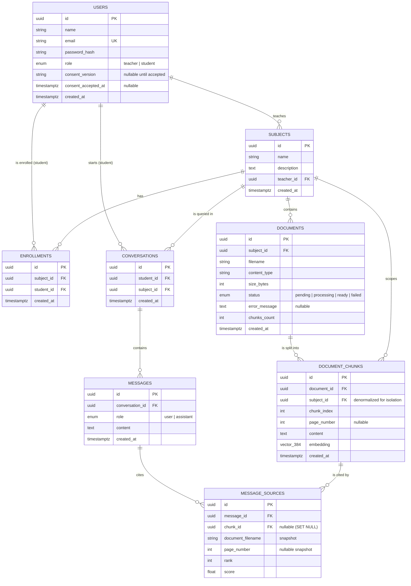

# Data Model (AsistenteIA)

Canonical database model. PostgreSQL 15 + `pgvector`. Managed only through Alembic migrations.
`readme.md` section 3 is a simplified academic summary; if they diverge, this document wins (see `base-standards.md` §0).

Status: **proposed design for implementation** — the differences from the `readme.md` summary are listed in [Changes vs readme.md](#changes-vs-readmemd).

## Entity Relationship Diagram

## Entities

### users
- `id` uuid PK (default `gen_random_uuid()`); `name` varchar(100) not null; `email` varchar(255) unique not null (stored lowercase, enforced by check constraint `ck_users_email_lowercase`: `email = lower(email)`); `password_hash` text not null (Argon2id); `role` PostgreSQL enum type `user_role` (`teacher`, `student`) not null.
- `consent_version` varchar(20) and `consent_accepted_at` timestamptz: evidence of the privacy-policy acceptance; only the latest acceptance is stored (re-acceptance overwrites both). The recorded version must equal the currently configured policy version (`PRIVACY_POLICY_VERSION`). The API must refuse chat usage until consent for the current version is recorded (enforced by the chat change).
- Teacher accounts are created only by the `python -m app.cli create-teacher` and `seed` commands (public registration creates students), so a role can never be self-assigned.
- Validation: email format; password length 10-128 (validated at the API layer, never stored).
- Created by migration `0002` (downgrade drops the table, then the `user_role` type).

### subjects
- `teacher_id` FK → users (must have role `teacher`, enforced in the service layer). Unique `(teacher_id, name)`.

### enrollments
- Links a student to a subject. Unique `(subject_id, student_id)`. The student must have role `student` (service layer).
- Created by the subject's teacher (by student email). Self-enrolment is not part of the MVP.

### documents
- One row per uploaded **original file**. The original binary is not stored in the database (see backend standards, "File handling"); only metadata and extracted chunks are.
- `status`: `pending` → `processing` → `ready` | `failed`. `error_message` is a short, non-sensitive reason for `failed`.
- Supported `content_type`: `application/pdf`, `text/plain` (and `text/markdown`). Max size configured via `MAX_UPLOAD_MB`.

### document_chunks
- One row per **text fragment** with its embedding. `embedding` is `vector(384)` (`paraphrase-multilingual-MiniLM-L12-v2`).
- `subject_id` is intentionally denormalized so that every similarity query can filter by subject without a join and the index/scoping cannot be bypassed by forgetting the join. It must always equal `documents.subject_id` (enforced by the repository when inserting).
- Unique `(document_id, chunk_index)`.
- Indexes: `hnsw (embedding vector_cosine_ops)`; b-tree on `(subject_id)`.
- Chunk size must fit the embedding model's input limit (about 128 word pieces; verify against the model card) — see backend standards.

### conversations
- One thread of a student about one subject. The student must be enrolled in the subject when the conversation is created.
- Index on `(student_id, subject_id, created_at)`.

### messages
- `role` enum `user|assistant`. Assistant messages have 0..N `message_sources`.

### message_sources
- Citation of a chunk used to build an assistant answer. `document_filename` and `page_number` are **snapshots** so a citation remains readable if the document is later deleted (`chunk_id` becomes NULL).
- `rank` (1 = most relevant) and `score` (cosine similarity) allow RAG quality analysis.

## Referential actions

| Relationship | On delete |
|---|---|
| subjects.teacher_id → users | RESTRICT (a teacher's subjects must be deleted/reassigned first) |
| enrollments.subject_id → subjects | CASCADE |
| enrollments.student_id → users | CASCADE |
| documents.subject_id → subjects | CASCADE |
| document_chunks.document_id → documents | CASCADE |
| conversations.student_id → users | CASCADE (right to erasure) |
| conversations.subject_id → subjects | CASCADE |
| messages.conversation_id → conversations | CASCADE |
| message_sources.message_id → messages | CASCADE |
| message_sources.chunk_id → document_chunks | SET NULL |

## Data protection rules

- Personal data: `users` (name, email), conversation content, consent evidence. No other personal data is stored.
- Right to erasure: deleting one conversation, deleting all of a student's conversations, or deleting the account removes rows physically (no soft delete) via the cascades above.
- Retention: conversation data lives until the user deletes it or the account is deleted. Application logs must not contain message content or document text.
- Third-party processing: message text and retrieved chunks are sent to Gemini. This must be disclosed in the privacy policy shown at consent time.

## Changes vs readme.md

1. Added `enrollments` (the readme requires "enrolled student" but had no entity).
2. Split the readme's `DOCUMENT` into `documents` (original file) and `document_chunks` (fragment + embedding).
3. Replaced `MESSAGE.source_document_id` by `message_sources` (an answer cites 1..N chunks).
4. Added consent fields to `users` and `status`/`error_message` to `documents`.
5. Index changed from `ivfflat` to `hnsw` (ivfflat quality depends on data existing when the index is built).

The `readme.md` summary (sections 2.5, 3, 4, 5 and 6) was aligned with these changes with the user's approval.
