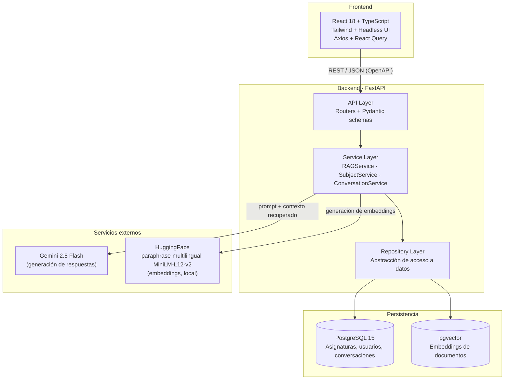
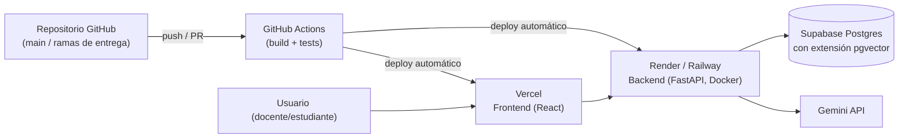
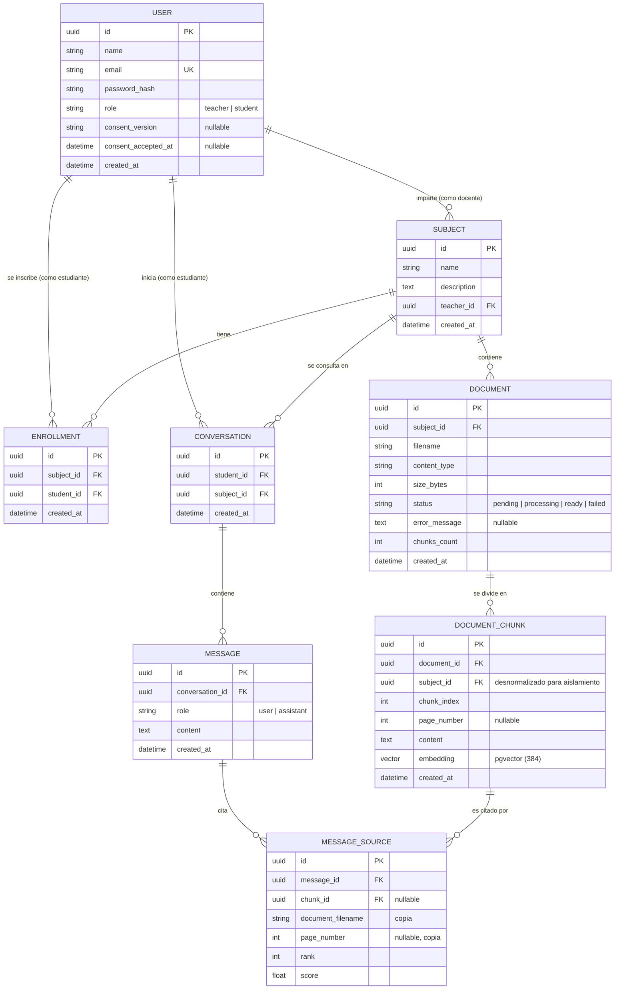

## Índice

0. [Ficha del proyecto](#0-ficha-del-proyecto)
1. [Descripción general del producto](#1-descripción-general-del-producto)
2. [Arquitectura del sistema](#2-arquitectura-del-sistema)
3. [Modelo de datos](#3-modelo-de-datos)
4. [Especificación de la API](#4-especificación-de-la-api)
5. [Historias de usuario](#5-historias-de-usuario)
6. [Tickets de trabajo](#6-tickets-de-trabajo)
7. [Pull requests](#7-pull-requests)

---

## 0. Ficha del proyecto

### **0.1. Tu nombre completo:**

Alejandro Nicolaide

### **0.2. Nombre del proyecto:**

AsistenteIA

### **0.3. Descripción breve del proyecto:**

AsistenteIA es un chatbot basado en RAG (Retrieval-Augmented Generation) que acompaña a estudiantes y tutores durante el recorrido académico, respondiendo dudas sobre el contenido de cada asignatura a partir del material cargado por los docentes.

### **0.4. URL del proyecto:**

Pendiente de despliegue.

> Puede ser pública o privada, en cuyo caso deberás compartir los accesos de manera segura. Puedes enviarlos a [alvaro@lidr.co](mailto:alvaro@lidr.co) usando algún servicio como [onetimesecret](https://onetimesecret.com/).

### 0.5. URL o archivo comprimido del repositorio

https://github.com/AlejandroNicolaide/AI4Devs-finalproject

> Puedes tenerlo alojado en público o en privado, en cuyo caso deberás compartir los accesos de manera segura. Puedes enviarlos a [alvaro@lidr.co](mailto:alvaro@lidr.co) usando algún servicio como [onetimesecret](https://onetimesecret.com/). También puedes compartir por correo un archivo zip con el contenido


---

## 1. Descripción general del producto

> Describe en detalle los siguientes aspectos del producto:

### **1.1. Objetivo:**

AsistenteIA busca resolver un problema frecuente en instituciones educativas (caso de uso de referencia: Instituto Delta, institución ficticia): los estudiantes tienen dudas puntuales sobre el contenido de sus asignaturas fuera del horario de clase, y los docentes no dan abasto para responder consultas repetitivas de forma individual.

AsistenteIA permite que cada docente cargue la bibliografía y el material de su asignatura, y que los estudiantes consulten esas dudas en cualquier momento, recibiendo respuestas ancladas al material real del curso (no respuestas genéricas), con la fuente citada para poder verificar la información. Esto libera tiempo docente para consultas de mayor valor y da a los estudiantes autonomía para aprender a su propio ritmo.

### **1.2. Características y funcionalidades principales:**

- **Gestión de asignaturas y carga de material (docente):** alta de asignatura, subida de documentos (PDF/texto) que alimentan la base de conocimiento de esa asignatura.
- **Consulta con RAG (estudiante):** el estudiante selecciona una asignatura y pregunta en lenguaje natural; recibe una respuesta generada a partir del material de esa asignatura, con referencia al documento/fragmento de origen.
- **Historial de conversación** por estudiante y asignatura.
- **Eliminación de historial de conversaciones (GDPR / derecho al olvido):** el estudiante puede borrar sus datos conversacionales almacenados.
- *(should-have, no incluido en el alcance obligatorio del MVP)* Panel de analítica para docentes con preguntas frecuentes y temas de mayor dificultad.

### **1.3. Diseño y experiencia de usuario:**

Pendiente: esta es la Entrega 1 (documentación técnica, sin código todavía). Las capturas/video de la experiencia de usuario se incorporarán a partir de la Entrega 2, cuando exista una interfaz funcional.

### **1.4. Instrucciones de instalación:**

Las instrucciones para poner en marcha el proyecto en local (Docker Compose con PostgreSQL 15 y pgvector, archivos de entorno con valores de ejemplo, comandos de calidad y procedimientos de la base de datos) viven en [`docs/development_guide.md`](docs/development_guide.md). El flujo completo de `docker compose up` con los servicios de un solo uso (`bootstrap` y `migrate`) no se ha ejercitado todavía sobre la base de desarrollo persistente, y el proyecto aún no está desplegado: no se debe ejecutar el *bootstrap* de la base de datos fuera de un clúster dedicado (ver 2.5).

---

## 2. Arquitectura del Sistema

### **2.1. Diagrama de arquitectura:**



**Patrón:** Arquitectura en capas (Layered Architecture) con **Repository Pattern** y **Service Layer**, sobre un pipeline RAG (LangChain) para la generación de respuestas.

**Por qué esta arquitectura:**
- Separa responsabilidades: la capa API no conoce lógica de negocio, el Service Layer no conoce detalles de persistencia, y el Repository Layer aísla el acceso a PostgreSQL/pgvector.
- Permite cambiar el proveedor de LLM, el modelo de embeddings o el vector store sin modificar routers ni lógica de negocio — relevante en un proyecto de IA donde estas piezas evolucionan rápido.
- Es el mismo patrón usado en los proyectos de referencia (Example1 y Example2) porque es el enfoque estándar para este tipo de sistema; la decisión se adoptó por ser la solución correcta al problema, no por copia.

**Déficits/sacrificios:**
- Para un MVP de este tamaño, las capas añaden código de "paso" (boilerplate) que en un prototipo más pequeño no sería estrictamente necesario.
- Mayor curva de entendimiento inicial del proyecto frente a un monolito simple sin separación de capas.

### **2.2. Descripción de componentes principales:**

- **Frontend (React 18 + TypeScript):** interfaz para docentes (gestión de asignaturas y material) y estudiantes (chat por asignatura). Se comunica con el backend vía REST usando Axios, con React Query para cacheo y estado de las peticiones.
- **API Layer (FastAPI):** expone los endpoints REST, documentados automáticamente vía OpenAPI/Swagger. Valida entrada/salida con esquemas Pydantic. No contiene lógica de negocio.
- **Service Layer:**
  - `RAGService`: orquesta el pipeline RAG (chunking del material subido, generación de embeddings, recuperación de fragmentos relevantes por similitud, construcción del prompt con contexto, llamada al LLM).
  - `SubjectService`: gestión de asignaturas y material asociado.
  - `ConversationService`: historial de conversaciones por estudiante/asignatura y borrado de historial (GDPR).
- **Repository Layer:** abstrae el acceso a datos (SQLAlchemy sobre PostgreSQL para entidades relacionales, consultas de similitud vectorial sobre pgvector). Toda consulta de fragmentos, conversaciones y mensajes se filtra por asignatura y por usuario dentro del repositorio, no solo en los routers.
- **PostgreSQL 15 + pgvector:** base de datos relacional única, con la extensión pgvector para almacenar y consultar embeddings por similitud — evita mantener una base de datos vectorial separada.
- **Gemini 2.5 Flash:** modelo de lenguaje externo, usado en la etapa de generación de la respuesta final a partir del contexto recuperado.
- **HuggingFace `paraphrase-multilingual-MiniLM-L12-v2`:** modelo de embeddings multilingüe, ejecutado localmente (sin costo por llamada), usado tanto para indexar el material de las asignaturas como para vectorizar las preguntas de los estudiantes.

### **2.3. Descripción de alto nivel del proyecto y estructura de ficheros**

El proyecto está organizado como un **monorepo** con dos aplicaciones independientes (`backend` y `frontend`), cada una desplegable por separado, comunicadas vía REST.

```
backend/
  app/
    api/v1/endpoints/   # Routers FastAPI (subjects, chat, documents)
    services/           # Lógica de negocio: rag_service, subject_service, conversation_service
    repositories/        # Acceso a datos (SQLAlchemy + consultas pgvector)
    models/              # Entidades SQLAlchemy (Subject, Document, Conversation, Message)
    schemas/             # Esquemas Pydantic (request/response)
    core/                # Configuración, variables de entorno, secretos
    main.py              # Punto de entrada de la app FastAPI
frontend/
  src/
    pages/                # Vistas (login, listado de asignaturas, chat, panel docente)
    components/           # Componentes de UI reutilizables
    hooks/                 # Hooks propios (React Query, estado de chat)
    services/              # Llamadas a la API (Axios)
```

Los estándares técnicos de implementación, el modelo de datos canónico y el contrato completo de la API viven en `docs/` (ver [`docs/base-standards.md`](docs/base-standards.md)); este README es el resumen académico de la entrega.

La estructura del `backend` refleja directamente las capas descritas en 2.1/2.2 (API → Services → Repositories → Models), de modo que cada carpeta corresponde a una responsabilidad concreta del patrón Layered Architecture + Repository Pattern. El `frontend` sigue una organización estándar por tipo de artefacto (páginas, componentes, hooks, servicios), habitual en proyectos React con TypeScript.

### **2.4. Infraestructura y despliegue**

> Nota: a fecha de esta entrega (Entrega 1 - documentación), el proyecto aún no está desplegado. Esta sección describe el plan de infraestructura y despliegue previsto para las siguientes entregas.



**Componentes de infraestructura:**
- **Frontend:** desplegado en **Vercel**, con integración directa al repositorio (deploy automático en cada push a la rama principal).
- **Backend:** desplegado en **Render** o **Railway** como contenedor (Docker), a partir de la carpeta `backend/`.
- **Base de datos:** **Supabase Postgres**, que incluye la extensión `pgvector` habilitada por defecto, evitando gestionar infraestructura de base de datos propia. Es el plan de despliegue; el modelo de roles de PostgreSQL descrito en 2.5 se implementó y validó solo sobre un PostgreSQL 15 con pgvector dedicado (desarrollo), de modo que adaptarlo a un servicio gestionado como Supabase requiere una decisión y una revisión antes de desplegar (`docs/technical-debt.md`, TD-044). Fusionar código en `main` no es desplegarlo.
- **CI/CD:** **GitHub Actions**, con un workflow simple que ejecuta build y tests en cada push/PR antes de habilitar el despliegue automático.
- **Secretos:** claves de API (Gemini) y credenciales de base de datos gestionadas como variables de entorno en cada plataforma (Vercel/Render), nunca versionadas en el repositorio.

Esta combinación se eligió por ser gestionada (sin necesidad de administrar servidores, Kubernetes o Terraform), adecuada al alcance de un MVP académico, con despliegue automático desde el propio repositorio.

### **2.5. Seguridad**

- **Autenticación y roles:** acceso diferenciado por rol (docente/estudiante) mediante JWT con expiración corta y contraseñas con hash argon2; un docente solo gestiona el material de sus propias asignaturas, y un estudiante solo consulta asignaturas en las que está inscrito y accede a su propio historial. El registro público crea solo estudiantes; los docentes se crean por seed/CLI.
- **Mínimo privilegio en la base de datos:** la aplicación no usa el superusuario de PostgreSQL. Hay cinco identidades (administrador, migrador, aplicación, *worker* y CLI), cada una con los privilegios mínimos de una matriz declarativa (`backend/app/db_privileges.py`, documentada en [`docs/data-model.md`](docs/data-model.md)); el API y el *worker* se niegan a arrancar como superusuario, las tablas pertenecen al migrador, `PUBLIC` queda sin acceso a las bases y al esquema, y `db-verify` compara el catálogo con la matriz. Los comandos `db-bootstrap` y `db-adopt` son de un solo uso, **no se ejecutan automáticamente** y `db-bootstrap` cierra `PUBLIC` en todas las bases del clúster, por lo que solo se usa en un clúster dedicado. Las limitaciones conocidas están en `docs/technical-debt.md` y la guía en [`docs/development_guide.md`](docs/development_guide.md).
- **Aislamiento de datos:** la recuperación vectorial siempre se restringe a la asignatura consultada, y una conversación debe pertenecer al usuario y a la asignatura de la petición. Los recursos de otros usuarios responden 404.
- **Protección frente a prompt injection:** los documentos subidos y las preguntas se tratan como datos no confiables: el prompt delimita el contexto recuperado, instruye responder solo con él, el modelo no recibe herramientas y no se registran contenidos en logs.
- **Protección de datos (GDPR):**
  - Minimización de datos: solo se almacena lo estrictamente necesario para el funcionamiento (identificador de usuario, mensajes de la conversación, asignatura asociada), sin datos sensibles adicionales.
  - Consentimiento explícito: el usuario acepta el tratamiento de sus datos conversacionales en el primer login (aceptación de política de privacidad); se guarda la versión y la fecha de aceptación, y el chat se bloquea hasta aceptar. La política informa que los mensajes y fragmentos recuperados se envían a Gemini (encargado de tratamiento).
  - Derecho al olvido: el estudiante puede eliminar una conversación, todo su historial o su cuenta desde la propia aplicación; el borrado es físico (funcionalidad ya listada en 1.2).
  - Cifrado en tránsito: comunicación exclusivamente vía HTTPS entre frontend, backend y base de datos.
  - Cifrado en reposo: gestionado por el proveedor de base de datos (Supabase Postgres).
  - Retención: los datos conversacionales se conservan solo mientras la cuenta esté activa o hasta que el usuario solicite su borrado.
- **Gestión de secretos:** claves de API (Gemini) y credenciales de base de datos como variables de entorno, nunca en el repositorio.
- **Validación de entrada:** esquemas Pydantic en cada endpoint, previniendo inyección y payloads malformados antes de llegar a la capa de servicio.

### **2.6. Tests**

> Nota: a fecha de esta entrega (Entrega 1 - documentación) aún no existe código; esta sección describe la estrategia de testing planificada para las siguientes entregas.

- **Backend (Pytest):** tests unitarios sobre el Service Layer (ej. `RAGService` con mocks del LLM y del retriever), y tests de integración sobre los endpoints principales (`/subjects`, `/chat`, `/documents`) usando una base de datos de test.
- **Frontend (Vitest + React Testing Library):** tests unitarios de componentes clave (formulario de carga de material, componente de chat).
- **E2E (Playwright, planificado para la entrega final):** al menos un flujo completo — docente sube material → estudiante pregunta → recibe respuesta con fuente citada.
- **Pruebas de seguridad y aislamiento:** cada regla de autorización tiene un test negativo (rol incorrecto, asignatura ajena, estudiante no inscrito, conversación ajena) y se prueba que una pregunta en una asignatura nunca recupera fragmentos de otra. Gemini nunca se invoca en CI (se usan dobles de prueba).
- Cobertura: no obligatoria en esta entrega; se retoma explícitamente en la Entrega 3 (final), según la guía del máster.

---

## 3. Modelo de Datos

> Resumen académico. La fuente canónica y más detallada es [`docs/data-model.md`](docs/data-model.md) (índices, acciones referenciales, reglas de protección de datos).

### **3.1. Diagrama del modelo de datos:**



### **3.2. Descripción de entidades principales:**

- **User**: docentes y estudiantes.
  - `id` (PK, uuid), `name` (not null), `email` (unique, not null), `password_hash` (argon2, not null), `role` (enum `teacher` | `student`, not null), `consent_version` y `consent_accepted_at` (evidencia de aceptación de la política de privacidad, nullable hasta aceptar), `created_at`.
  - El registro público crea solo estudiantes; las cuentas de docente se crean por seed/CLI para evitar auto-asignación de rol.

- **Subject** (asignatura): creada por un docente.
  - `id` (PK), `name` (not null), `description`, `teacher_id` (FK → User, not null), `created_at`. Único `(teacher_id, name)`.

- **Enrollment** (inscripción): vincula a un estudiante con una asignatura; es lo que autoriza sus consultas.
  - `id` (PK), `subject_id` (FK → Subject, `ON DELETE CASCADE`), `student_id` (FK → User, `ON DELETE CASCADE`), `created_at`. Único `(subject_id, student_id)`. La crea el docente titular, indicando el email del estudiante.

- **Document**: archivo original subido por el docente (solo metadatos; el binario no se persiste en el MVP).
  - `id` (PK), `subject_id` (FK, `ON DELETE CASCADE`), `filename`, `content_type`, `size_bytes`, `status` (`pending` → `processing` → `ready` | `failed`), `error_message` (nullable), `chunks_count`, `created_at`.

- **DocumentChunk**: fragmento de texto de un documento con su embedding.
  - `id` (PK), `document_id` (FK, `ON DELETE CASCADE`), `subject_id` (FK, desnormalizado para filtrar siempre por asignatura), `chunk_index`, `page_number` (nullable), `content` (text), `embedding` (`vector(384)`, HuggingFace `paraphrase-multilingual-MiniLM-L12-v2`, índice `hnsw` coseno), `created_at`.

- **Conversation**: hilo de consultas de un estudiante sobre una asignatura.
  - `id` (PK), `student_id` (FK → User, `ON DELETE CASCADE`), `subject_id` (FK → Subject), `created_at`. Relación 1:N con `Message`.

- **Message**: turno de una conversación.
  - `id` (PK), `conversation_id` (FK, `ON DELETE CASCADE`), `role` (`user` | `assistant`), `content`, `created_at`.

- **MessageSource**: cita de un fragmento usada para construir una respuesta del asistente (una respuesta puede citar 1..N fragmentos).
  - `id` (PK), `message_id` (FK, `ON DELETE CASCADE`), `chunk_id` (FK nullable, `ON DELETE SET NULL`), `document_filename` y `page_number` (copias para que la cita siga siendo legible si se borra el documento), `rank`, `score` (similitud coseno).

---

## 4. Especificación de la API

El backend expone una API REST (FastAPI, documentada automáticamente vía OpenAPI/Swagger). A continuación se describen los 3 endpoints principales del flujo core. El contrato completo (autenticación, asignaturas, inscripciones, historial, borrado total de datos) está en [`docs/api-spec.yml`](docs/api-spec.yml), que es la fuente canónica.

### 4.1. Subir material de una asignatura

```yaml
openapi: 3.0.0
paths:
  /subjects/{subject_id}/documents:
    post:
      summary: Sube un documento de material a una asignatura (rol docente titular)
      tags: [Documents]
      security:
        - bearerAuth: []
      parameters:
        - name: subject_id
          in: path
          required: true
          schema:
            type: string
            format: uuid
      requestBody:
        required: true
        content:
          multipart/form-data:
            schema:
              type: object
              properties:
                file:
                  type: string
                  format: binary
      responses:
        '202':
          description: Archivo aceptado; el procesamiento (extracción, chunking, embeddings) continúa en segundo plano
          content:
            application/json:
              schema:
                type: object
                properties:
                  id:
                    type: string
                    format: uuid
                  filename:
                    type: string
                  status:
                    type: string
                    enum: [pending, processing, ready, failed]
                  chunks_count:
                    type: integer
        '403':
          description: El usuario no es docente titular de esta asignatura
        '413':
          description: Archivo demasiado grande
        '415':
          description: Formato de archivo no soportado
```

El estado final (`ready` con la cantidad de fragmentos, o `failed` con un mensaje de error) se consulta con `GET /subjects/{subject_id}/documents`.

**Ejemplo de respuesta:**
```json
{
  "id": "3f1a9c2e-1234-4a5b-8c9d-abcdef123456",
  "filename": "unidad1-introduccion.pdf",
  "status": "processing",
  "chunks_count": 0
}
```

### 4.2. Consultar al asistente (chat RAG)

```yaml
openapi: 3.0.0
paths:
  /chat:
    post:
      summary: Envía una pregunta sobre una asignatura y recibe una respuesta generada con RAG
      tags: [Chat]
      security:
        - bearerAuth: []
      requestBody:
        required: true
        content:
          application/json:
            schema:
              type: object
              required: [subject_id, message]
              properties:
                subject_id:
                  type: string
                  format: uuid
                conversation_id:
                  type: string
                  format: uuid
                  nullable: true
                message:
                  type: string
                  maxLength: 2000
      responses:
        '200':
          description: Respuesta generada por el asistente
          content:
            application/json:
              schema:
                type: object
                properties:
                  conversation_id:
                    type: string
                    format: uuid
                  message_id:
                    type: string
                    format: uuid
                  answer:
                    type: string
                  no_material:
                    type: boolean
                  sources:
                    type: array
                    items:
                      type: object
                      properties:
                        document_id:
                          type: string
                          format: uuid
                        filename:
                          type: string
                        page_number:
                          type: integer
                          nullable: true
                        snippet:
                          type: string
        '403':
          description: Estudiante no inscrito en la asignatura o sin consentimiento registrado
        '502':
          description: El proveedor del LLM falló o bloqueó la respuesta
```

**Ejemplo de petición:**
```json
{
  "subject_id": "b2c3d4e5-1111-2222-3333-abcdef123456",
  "message": "¿Qué diferencia hay entre RAG y fine-tuning?"
}
```

**Ejemplo de respuesta:**
```json
{
  "conversation_id": "9a8b7c6d-4444-5555-6666-abcdef123456",
  "message_id": "1f2e3d4c-7777-8888-9999-abcdef123456",
  "answer": "Según el material de la unidad 1, RAG recupera contexto relevante en tiempo de consulta sin modificar los pesos del modelo, mientras que el fine-tuning reentrena el modelo con datos específicos...",
  "no_material": false,
  "sources": [
    {
      "document_id": "3f1a9c2e-1234-4a5b-8c9d-abcdef123456",
      "filename": "unidad1-introduccion.pdf",
      "page_number": 4,
      "snippet": "RAG combina recuperación con generación..."
    }
  ]
}
```

### 4.3. Eliminar historial de conversación (GDPR)

```yaml
openapi: 3.0.0
paths:
  /conversations/{conversation_id}:
    delete:
      summary: Elimina una conversación y sus mensajes asociados (derecho al olvido)
      tags: [Conversations]
      security:
        - bearerAuth: []
      parameters:
        - name: conversation_id
          in: path
          required: true
          schema:
            type: string
            format: uuid
      responses:
        '204':
          description: Conversación eliminada correctamente
        '404':
          description: Conversación no encontrada o no pertenece al usuario autenticado
```

Para no revelar la existencia de conversaciones de otros usuarios, el acceso a una conversación ajena responde 404 (no 403). El borrado de todo el historial (`DELETE /users/me/conversations`) y de la cuenta (`DELETE /users/me`) están en `docs/api-spec.yml`.

---

## 5. Historias de Usuario

> Documenta 3 de las historias de usuario principales utilizadas durante el desarrollo, teniendo en cuenta las buenas prácticas de producto al respecto.

**Historia de Usuario 1 — Carga de material de asignatura**

**Prioridad:** Must-have

**Como** docente,
**quiero** subir documentos (PDF/texto) al material de mi asignatura,
**para que** el asistente pueda responder dudas de mis estudiantes basándose en mi contenido oficial.

**Criterios de aceptación (Gherkin):**

```gherkin
Escenario: Carga exitosa de material
  Dado que soy un docente autenticado y soy titular de la asignatura "Introducción a IA"
  Cuando subo un archivo PDF con el contenido de la unidad 1
  Entonces el sistema procesa el documento (chunking + embeddings) sin intervención manual
  Y recibo una confirmación de que el documento fue aceptado
  Y puedo consultar su estado de procesamiento (procesando, listo con la cantidad de fragmentos, o fallido con un motivo)

Escenario: Intento de carga en asignatura ajena
  Dado que soy un docente autenticado que no es titular de la asignatura "Cálculo II"
  Cuando intento subir un documento a esa asignatura
  Entonces el sistema rechaza la operación con un error 404

Escenario: Formato de archivo no soportado
  Dado que soy un docente autenticado y titular de la asignatura
  Cuando intento subir un archivo con un formato no soportado (ej. .exe)
  Entonces el sistema rechaza el archivo y muestra un mensaje de error claro
```

---

**Historia de Usuario 2 — Consulta al asistente académico (RAG)**

**Prioridad:** Must-have

**Como** estudiante,
**quiero** preguntar dudas sobre el contenido de una asignatura,
**para que** reciba una respuesta basada en el material oficial del curso, con la fuente citada, sin depender de la disponibilidad del docente.

**Criterios de aceptación (Gherkin):**

```gherkin
Escenario: Pregunta con material disponible
  Dado que soy un estudiante autenticado e inscrito en la asignatura "Introducción a IA"
  Y la asignatura tiene material indexado
  Cuando envío la pregunta "¿Qué diferencia hay entre RAG y fine-tuning?"
  Entonces recibo una respuesta generada a partir del material de esa asignatura
  Y la respuesta incluye referencias a los documentos y fragmentos de origen

Escenario: Pregunta sin material cargado aún
  Dado que soy un estudiante autenticado e inscrito en una asignatura sin material indexado
  Cuando envío una pregunta
  Entonces el sistema me informa que todavía no hay material disponible para esa asignatura,
  en lugar de generar una respuesta sin fuente verificable

Escenario: Continuación de una conversación existente
  Dado que ya tengo una conversación abierta en una asignatura
  Cuando envío una nueva pregunta relacionada
  Entonces la respuesta se genera teniendo en cuenta el historial de esa conversación
```

---

**Historia de Usuario 3 — Eliminación de historial de conversación (GDPR)**

**Prioridad:** Must-have

**Como** estudiante,
**quiero** poder eliminar mi historial de conversaciones con el asistente,
**para que** pueda ejercer mi derecho al olvido sobre mis datos personales.

**Criterios de aceptación (Gherkin):**

```gherkin
Escenario: Eliminación exitosa de una conversación propia
  Dado que soy un estudiante autenticado con una conversación existente
  Cuando solicito eliminar esa conversación
  Entonces el sistema borra la conversación y todos sus mensajes asociados
  Y la operación no puede deshacerse

Escenario: Intento de eliminar una conversación ajena
  Dado que soy un estudiante autenticado
  Cuando intento eliminar una conversación que pertenece a otro estudiante
  Entonces el sistema rechaza la operación con un error 403

Escenario: Eliminación de conversación inexistente
  Dado que soy un estudiante autenticado
  Cuando solicito eliminar una conversación con un identificador que no existe
  Entonces el sistema responde con un error 404
```

---

## 6. Tickets de Trabajo

> Documenta 3 de los tickets de trabajo principales del desarrollo, uno de backend, uno de frontend, y uno de bases de datos. Da todo el detalle requerido para desarrollar la tarea de inicio a fin teniendo en cuenta las buenas prácticas al respecto. 

**Ticket 1 — [BACKEND] Implementar endpoint `POST /chat` con pipeline RAG**

**Historia de usuario relacionada:** HU-2 (Consulta al asistente académico)

**Descripción:** Implementar el endpoint `POST /chat`, que recibe una pregunta de un estudiante sobre una asignatura y devuelve una respuesta generada mediante RAG, citando el documento de origen.

**Tareas técnicas:**
- Crear router `chat.py` en `api/v1/endpoints/` con el endpoint `POST /chat`, validado con un schema Pydantic (`subject_id`, `conversation_id` opcional, `message`).
- Implementar `RAGService.answer(subject_id, message, conversation_id)`:
  - Generar embedding de la pregunta (HuggingFace `paraphrase-multilingual-MiniLM-L12-v2`).
  - Recuperar los N fragmentos más relevantes de `DocumentChunk` para esa asignatura vía `ChunkRepository` (similitud coseno sobre pgvector, filtrado obligatorio por `subject_id`).
  - Construir el prompt con el contexto recuperado (LangChain) e invocar Gemini 2.5 Flash.
  - Persistir los mensajes (pregunta + respuesta) en `Conversation`/`Message` y las citas en `MessageSource` vía `ConversationRepository`.
- Manejar el caso de asignatura sin material indexado (respuesta controlada, no error 500).
- Proteger el endpoint con autenticación JWT (rol estudiante, inscrito en la asignatura, consentimiento registrado) y validar que `conversation_id` pertenezca al usuario y a la misma asignatura.
- Manejar errores de Gemini (timeout, cuota, bloqueo de seguridad) con reintentos acotados y respuesta 502 controlada; delimitar el contexto en el prompt como defensa contra prompt injection.
- Tests unitarios de `RAGService` con mocks del LLM y del repositorio de documentos; test de integración del endpoint con base de datos de test.

**Criterios de aceptación:**
- Dada una asignatura con material indexado, al enviar una pregunta se recibe una respuesta con al menos una fuente en `sources`.
- Dada una asignatura sin material, se recibe una respuesta controlada indicando que no hay contenido disponible (no un error).
- El endpoint rechaza con 401/403 a usuarios no autenticados o no inscritos en la asignatura.
- Una pregunta en la asignatura A nunca recupera fragmentos de la asignatura B.

**Estimación:** 8 puntos (talla M/L) · **Dependencias:** Ticket 3 (esquema de `DocumentChunk` con pgvector debe existir antes).

---

**Ticket 2 — [FRONTEND] Interfaz de chat por asignatura**

**Historia de usuario relacionada:** HU-2 (Consulta al asistente académico)

**Descripción:** Construir la pantalla de chat donde el estudiante selecciona una asignatura, escribe preguntas y visualiza las respuestas del asistente junto con la fuente citada.

**Tareas técnicas:**
- Crear página `pages/ChatPage.tsx`, accesible desde el listado de asignaturas del estudiante.
- Componente `ChatWindow` con lista de mensajes (usuario/asistente) y input de texto.
- Componente `MessageBubble` que renderiza el contenido como texto y, si existen, chips con el `filename` y la página de cada fuente en `sources`.
- Hook `useChat(subjectId)` (React Query) que llama a `POST /chat` vía `services/chatService.ts` (Axios), maneja estado de carga y error.
- Estado de "escribiendo..." mientras se espera la respuesta del backend.
- Manejo de error visible si el backend responde que no hay material indexado para la asignatura.
- Tests de componente (Vitest + React Testing Library) para `ChatWindow` y `MessageBubble`.

**Criterios de aceptación:**
- El estudiante puede enviar una pregunta y ver la respuesta renderizada con las fuentes citadas, si existen.
- Mientras se espera la respuesta, se muestra un indicador de carga (no queda la UI congelada ni duplicable el envío).
- Si el backend indica que no hay material disponible, se muestra un mensaje claro en la propia conversación (no un error genérico).

**Estimación:** 5 puntos (talla M) · **Dependencias:** Ticket 1 (endpoint `/chat` debe estar disponible, al menos con mock).

---

**Ticket 3 — [BASE DE DATOS] Esquema de `Document` y `DocumentChunk` con soporte de embeddings (pgvector)**

**Historia de usuario relacionada:** HU-1 y HU-2 (base necesaria para carga de material y para consulta RAG)

**Descripción:** Crear la migración de base de datos para las tablas `documents` (archivo original) y `document_chunks` (fragmentos), incluyendo la columna de embeddings con `pgvector` y el índice necesario para búsquedas por similitud eficientes.

**Tareas técnicas:**
- Habilitar la extensión `vector` en PostgreSQL (`CREATE EXTENSION IF NOT EXISTS vector;`).
- Crear migración (Alembic) para `documents` (`id`, `subject_id` FK `ON DELETE CASCADE`, `filename`, `content_type`, `size_bytes`, `status`, `error_message`, `chunks_count`, `created_at`) y `document_chunks` (`id`, `document_id` FK `ON DELETE CASCADE`, `subject_id` FK, `chunk_index`, `page_number`, `content`, `embedding vector(384)`, `created_at`). El detalle completo está en `docs/data-model.md`.
- Crear índice `hnsw` sobre `embedding` con operador de distancia coseno (preferido sobre `ivfflat`, que depende de que existan datos al construir el índice) y un índice b-tree sobre `subject_id`.
- Definir los modelos SQLAlchemy `Document` y `DocumentChunk` y el repositorio `ChunkRepository` con el método `find_similar(subject_id, query_embedding, top_k)`, donde `subject_id` es un parámetro obligatorio.
- Seed de datos de prueba (algunos documentos de ejemplo con embeddings precalculados) para poder probar el flujo end-to-end sin depender de la carga real.

**Criterios de aceptación:**
- La migración se ejecuta sin errores sobre una base de datos limpia y es reversible (`downgrade`).
- `ChunkRepository.find_similar` devuelve los fragmentos ordenados por similitud (menor distancia coseno primero), filtrados por `subject_id`.
- Eliminar una asignatura elimina en cascada sus documentos y fragmentos; eliminar un documento elimina sus fragmentos.

**Estimación:** 5 puntos (talla M) · **Dependencias:** ninguna (ticket base, primero en el orden de ejecución).

---

## 7. Pull Requests

> Documenta 3 de las Pull Requests realizadas durante la ejecución del proyecto

Pendiente: esta es la Entrega 1 (documentación técnica, sin código todavía). Las Pull Requests se documentarán a partir de la Entrega 2, cuando exista desarrollo real sobre el repositorio.

**Pull Request 1**

**Pull Request 2**

**Pull Request 3**

